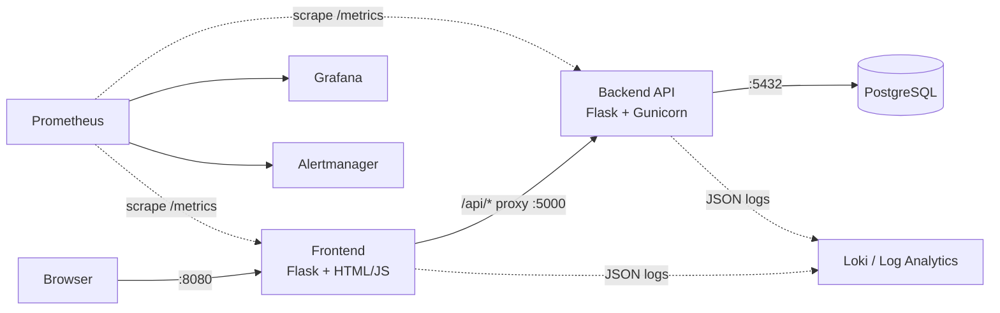

# Taskboard — 3-Tier Flask App

Practice app for containerization, CI/CD, observability, and alerting.
**No Dockerfiles, compose, or monitoring configs are included — that's your job.**

## Architecture



## Repo Layout

```
taskboard-3tier/
├── frontend/          # Tier 1 – UI + proxy to backend
│   ├── app.py
│   ├── templates/index.html
│   ├── static/app.js
│   └── requirements.txt
├── backend/           # Tier 2 – REST API
│   ├── app.py
│   ├── tests/test_api.py
│   └── requirements.txt
├── db/init.sql        # Tier 3 – schema + seed data
├── .env.example
└── README.md
```

## Endpoints

| Service  | Path                    | Purpose                         |
|----------|-------------------------|---------------------------------|
| frontend | `/`                     | UI                              |
| frontend | `/health`, `/metrics`   | Liveness, Prometheus metrics    |
| frontend | `/api/*`                | Proxied to backend              |
| backend  | `/health`               | Liveness (no DB)                |
| backend  | `/ready`                | Readiness (checks DB)           |
| backend  | `/metrics`              | Prometheus metrics              |
| backend  | `GET/POST /api/tasks`   | List / create                   |
| backend  | `PUT /api/tasks/<id>/toggle` | Toggle done                |
| backend  | `DELETE /api/tasks/<id>`| Delete                          |
| backend  | `/api/chaos/error`      | ~50% HTTP 500 — trigger alerts  |
| backend  | `/api/chaos/slow`       | 1–3s delay — trigger latency alerts |

## Environment Variables

See `.env.example`.

| Var | Used by | Default |
|-----|---------|---------|
| `DB_HOST` `DB_PORT` `DB_NAME` `DB_USER` `DB_PASSWORD` | backend | localhost / 5432 / taskboard / taskboard / changeme |
| `BACKEND_PORT` | backend | 5000 |
| `BACKEND_URL` | frontend | http://localhost:5000 |
| `FRONTEND_PORT` | frontend | 8080 |
| `LOG_LEVEL` | both | INFO |

## Run Locally (no Docker)

```bash
# 1. Postgres (any local instance), then:
psql -U postgres -c "CREATE USER taskboard WITH PASSWORD 'changeme';"
psql -U postgres -c "CREATE DATABASE taskboard OWNER taskboard;"
psql -U taskboard -d taskboard -f db/init.sql

# 2. Backend
cd backend && python -m venv .venv && source .venv/bin/activate
pip install -r requirements.txt
python app.py                      # or: gunicorn -b 0.0.0.0:5000 app:app

# 3. Frontend (new terminal)
cd frontend && python -m venv .venv && source .venv/bin/activate
pip install -r requirements.txt
python app.py                      # http://localhost:8080
```

Tests: `cd backend && pytest`

## Metrics Exposed

| Metric | Type | Labels |
|--------|------|--------|
| `http_requests_total` | Counter | service, method, endpoint, status |
| `http_request_duration_seconds` | Histogram | service, method, endpoint |
| `db_errors_total` | Counter | — |
| `tasks_total` | Gauge | state (open/done) |
| `backend_upstream_errors_total` | Counter | — (frontend → backend failures) |

Logs are single-line JSON on stdout (`ts, level, msg, service, method, path, status, duration_ms`).

## Your To-Do

### Containerize
- [ ] `backend/Dockerfile` (gunicorn, non-root user, healthcheck on `/health`)
- [ ] `frontend/Dockerfile`
- [ ] `docker-compose.yml` (frontend, backend, postgres + volume, mount `db/init.sql`)
- [ ] `.dockerignore` files
- [ ] Scan images with Trivy

### CI/CD
- [ ] Pipeline: lint → pytest → build → Trivy scan → push → deploy

### Observability
- [ ] Prometheus scraping frontend + backend
- [ ] `postgres_exporter` for DB metrics
- [ ] `node_exporter` / cAdvisor for host + container metrics
- [ ] Grafana dashboards: RED metrics (rate, errors, duration), DB, containers
- [ ] Centralized logs (Loki + Promtail, or Azure Log Analytics)

### Alerting (Alertmanager → Slack/email)
- [ ] 5xx error rate > 5% for 2m (use `/api/chaos/error`)
- [ ] p95 latency > 1s for 5m (use `/api/chaos/slow`)
- [ ] Target down (`up == 0`)
- [ ] `db_errors_total` increasing
- [ ] Postgres connections near max

### Stretch
- [ ] Kubernetes manifests / Helm chart
- [ ] Terraform for infra
- [ ] Load test with k6 or locust and watch the dashboards
